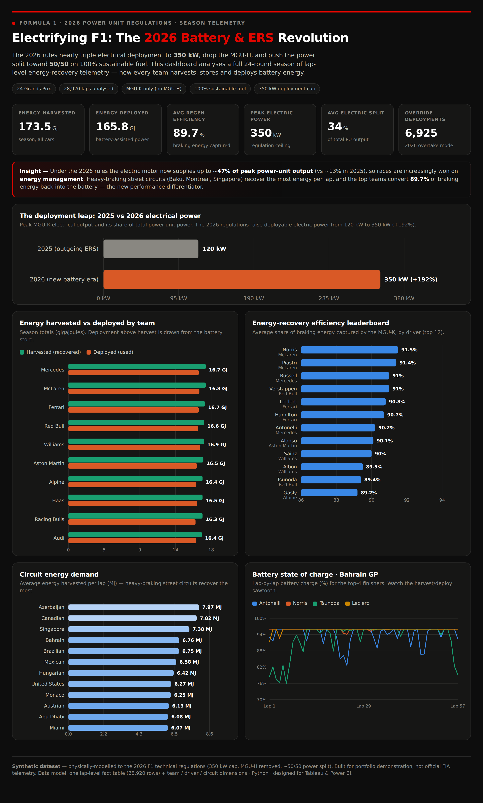
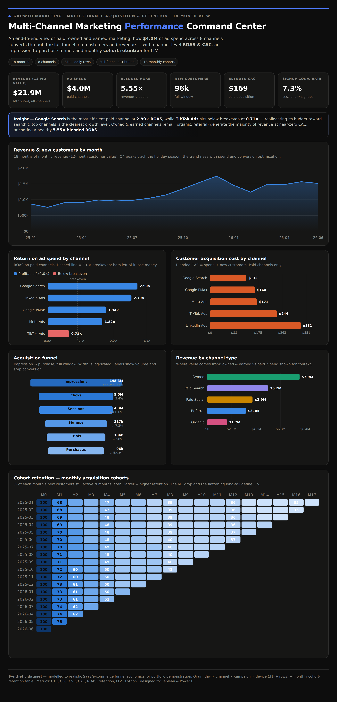

# 📈 Data Analytics Portfolio — Rohan Savani

Data & marketing analytics projects: data modelling in Python, and interactive dashboards designed for **Tableau** and **Power BI**. Each project ships a reproducible dataset, a build guide, and a self-contained interactive dashboard you can open in a browser.

📍 Dallas, TX · SQL • Python • GA4 • Tableau • Power BI

---

## ⭐ Featured dashboards

### ⚡ [Electrifying F1: The 2026 Battery & ERS Revolution](./F1-2026-Battery-ERS-Dashboard)
How Formula 1's 2026 power-unit rules (350 kW electric, no MGU-H, ~50/50 split, sustainable fuel) make **energy management** the new competitive edge. A full 24-race season of lap-level energy-recovery telemetry — harvest, storage, deployment and battery state-of-charge.

`Python` · `star-schema data modelling` · `28,920-row fact table` · `Tableau` · `Power BI`

[](./F1-2026-Battery-ERS-Dashboard)

---

### 📊 [Multi-Channel Marketing Performance Command Center](./Marketing-Performance-Dashboard)
A full-funnel view of $4.0M of marketing spend across 8 channels — **ROAS, CAC, LTV, funnel conversion and cohort retention** — that turns metrics into a clear budget-reallocation recommendation.

`Python` · `funnel & cohort analysis` · `ROAS / CAC / LTV` · `31k+ row daily fact table` · `Tableau` · `Power BI`

[](./Marketing-Performance-Dashboard)

---

## 💼 Job search tool

### 🔎 [Live job search with freehire](./Job-Search)
A standard-library Python CLI over the free [freehire](https://github.com/strelov1/freehire) API: search 3.3M+ live IT postings by title, location, remote/hybrid, seniority, skills and salary, see facet counts, and export to CSV.

```bash
python Job-Search/freehire_jobs.py search "data analyst" --countries US --cities Dallas
```

---

## 🔎 How each project is structured
```
<project>/
├── dashboard.html          # self-contained interactive dashboard (open in a browser)
├── preview.png             # dashboard screenshot
├── README.md               # overview, findings, data dictionary
├── data/                   # CSV datasets (fact + dimension + rollup tables)
├── scripts/                # Python: generate data → aggregate → build dashboard
└── docs/                   # Tableau & Power BI build guides + LinkedIn captions
```

Reproduce any project:
```bash
pip install pandas numpy
python scripts/generate_*_data.py
python scripts/build_aggregates.py
python scripts/build_dashboard.py
```

## 🗃️ Also in this repo
Earlier guided analysis notebooks (Python / pandas): Hacker News posts, eBay car sales, and App Store / Google Play profitability.

---
*Datasets in the two featured projects are synthetic and modelled for portfolio demonstration.*
